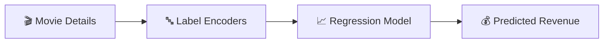

<div align="center">


<b><i>Predict movie revenue before the release</i></b>


       

   
</div>

---

## 🎬 About the Project

**Box Office Predictor** estimates a movie's **box-office revenue** using machine-learning regression. Users register, log in and enter movie details — title, genre, director, lead actor, country and more — and the trained model returns the predicted revenue instantly.

## ✨ Key Features

- 🔐 Register / login with **SQLite** user store
- 🎭 Encoded categorical features — genre, director, lead actor, country, title
- 📈 Regression model trained & evaluated in `box office.ipynb`
- 💰 Instant **revenue prediction** with a clean result page

## 🧠 How It Works



## 🛠️ Tech Stack

| Layer | Technology |
|---|---|
| Language | Python 3 |
| Data & ML | Pandas · NumPy · scikit-learn |
| Notebook | Jupyter |
| Web App | Flask + Jinja2 templates |
| Frontend | HTML5 · CSS3 |
| Database | SQLite (users.db) |

## 📂 Project Structure

```text
box office/
├── app.py                 # Flask app
├── box office.ipynb       # EDA + training
├── model.pkl              # regression model
├── genre.pkl · director.pkl · lead_actor.pkl · country.pkl · title.pkl
├── instance/users.db
├── static/css/style.css
└── templates/  (base, home, login, register, predict, result)
```

## 🚀 Getting Started

```bash
git clone https://github.com/PreciousBharath/BOX-OFFICE-PREDICTION.git
cd "BOX-OFFICE-PREDICTION/box office"
pip install flask flask-sqlalchemy pandas numpy scikit-learn
python app.py
```

## 🤝 Contributing

Contributions, issues and feature requests are welcome! Feel free to ⭐ star the repo and open a pull request.

## 👨‍💻 Author

<div align="center">

**Bharath** — Software Developer · Project Engineer · Technical Trainer

<a href="https://github.com/PreciousBharath"></a>
<a href="https://linkedin.com/in/connectbharath"></a>

### 🍔 EAT · 💻 CODE · 😴 SLEEP · 🔁 REPEAT

⭐ **If you found this project useful, give it a star!** ⭐


</div>
